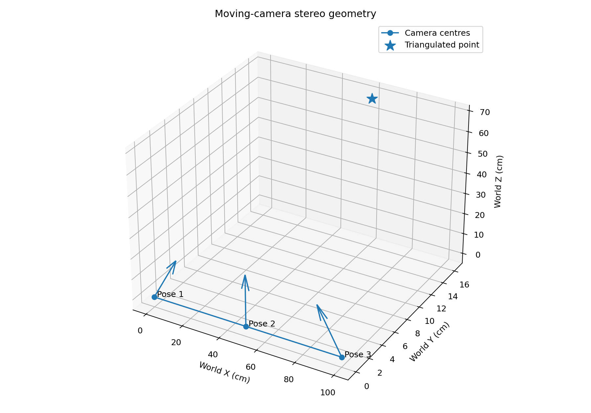
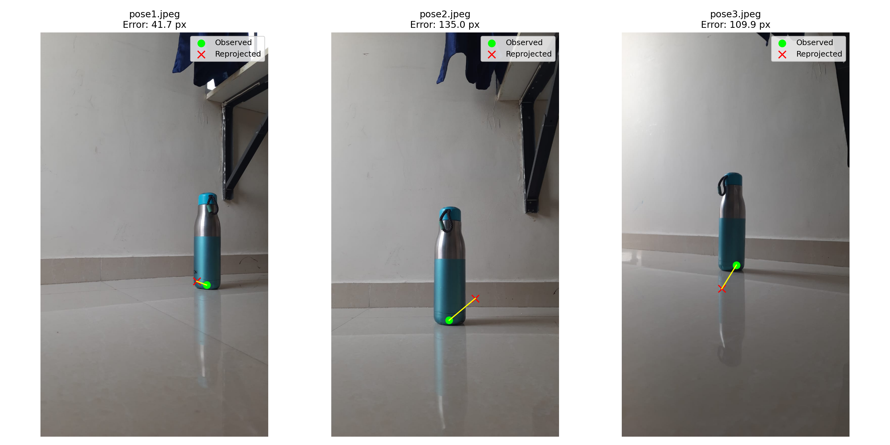
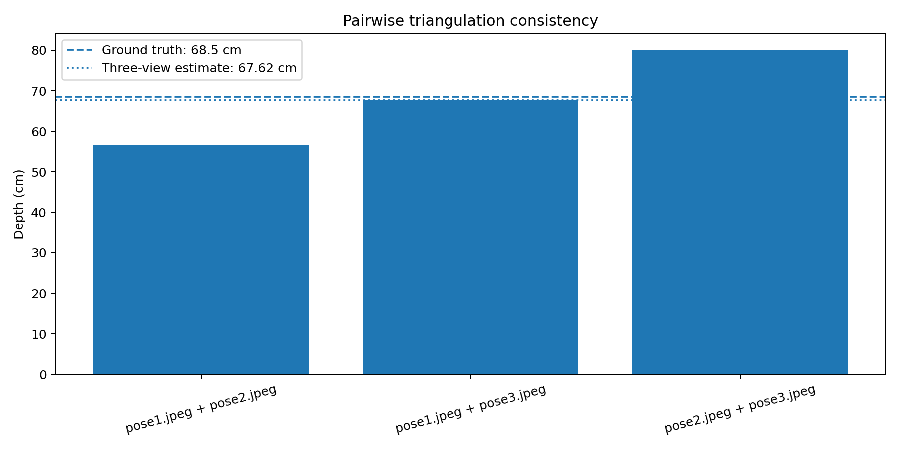
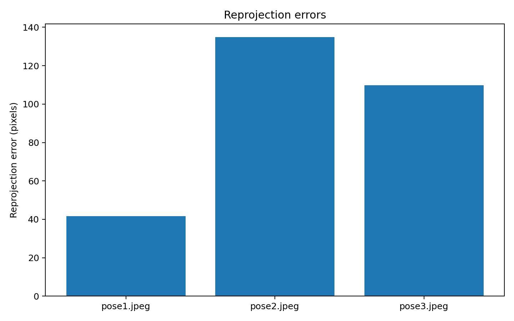
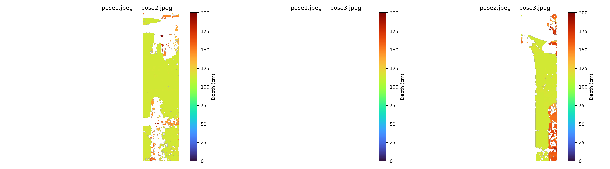

# Stereo Vision and Depth Analysis

This README is a presentation guide to the stereo depth implementation in `depth_analysis.py` and `visualizations.py`. It explains the geometry, data flow, assumptions, validation checks, and the results currently saved under `visualizations/`.

## Project goal

The goal is to estimate the 3D position of one identifiable point on a bottle from photographs taken at different camera positions. A single image gives a direction from the camera to the point, but not its distance. With views from known camera poses, the corresponding image points define several rays in 3D. Their intersection, or best-fit intersection in the presence of measurement noise, gives an estimate of the point's 3D location.

This is **multi-view stereo triangulation with manually supplied camera poses**. The user clicks the same physical bottle feature in each image, and the camera positions and yaw angles are configured in the scripts. `visualizations.py` also computes dense stereo depth maps from rectified image pairs.

## Files and responsibilities

- `camera_calibration.py` estimates the camera's intrinsic matrix and lens distortion from checkerboard images and saves them in `camera_calibration.npz`.
- `depth_analysis.py` performs the point selection, coordinate conversion, triangulation, and numeric checks. It saves the reconstructed point and metrics in `stereo_depth_results.npz`.
- `visualizations.py` repeats the same reconstruction pipeline and additionally saves five diagnostic plots in `visualizations/`, including pairwise dense depth maps.
- `bottle_images/` contains the three views: `pose1.jpeg`, `pose2.jpeg`, and `pose3.jpeg`.
- `calibration_images/` contains the checkerboard calibration images. `calibration_debug/` contains images with detected corners.

The two analysis scripts intentionally have nearly the same reconstruction logic so either can be run independently. When changing the experiment configuration, keep the values in both scripts aligned.

## Stereo vision concepts

### Why multiple views provide depth

Under the pinhole camera model, a 3D point projects to an image point. Many different 3D points lie along the same viewing ray, so one view alone cannot resolve depth. Moving the camera changes the viewing ray. Given the camera geometry and the same physical point's image location in two or more views, the rays can be triangulated.

In the simple rectified stereo case, depth is often introduced by the relation

\[
Z = \frac{fB}{d},
\]

where `f` is focal length, `B` is the distance between cameras (baseline), and `d` is disparity, the horizontal image displacement of a matched point. This project uses a more general formulation: camera views can be yawed and the images are not rectified, so it builds a projection matrix for each camera pose and solves the multi-view geometry directly. The underlying principle is still parallax: a point's apparent position changes as the viewpoint moves.

### Intrinsics and distortion

The camera intrinsic matrix is

\[
K = \begin{bmatrix} f_x & 0 & c_x \\ 0 & f_y & c_y \\ 0 & 0 & 1 \end{bmatrix},
\]

where `f_x`, `f_y` are focal lengths in pixel units and `(c_x, c_y)` is the principal point. Calibration also estimates lens distortion coefficients. `cv2.undistortPoints` removes the distortion and maps the clicked pixel coordinates into normalized camera coordinates. Normalized coordinates describe rays relative to the optical center and can be used with projection matrices that do not include `K`.

The analysis verifies that each bottle image has the same `(width, height)` as the calibration images. This matters because the intrinsic matrix is tied to the image resolution and camera configuration used during calibration.

### Coordinate frames and camera poses

The world frame used here is defined as:

- `X`: direction along the camera movement baseline;
- `Y`: vertical direction;
- `Z`: perpendicular depth away from that baseline.

The configured camera centers are `(0, 0, 0)`, `(50, 0, 0)`, and `(100, 0, 0)` cm, with yaw angles `31°`, `0°`, and `-31°`. `GROUND_TRUTH_DEPTH_CM` is configured as `68.5` cm. These values are experimental inputs, not quantities inferred by the triangulation code. Camera pose measurement errors directly affect the depth estimate.

For a camera center `C`, `rotation_yaw` forms a camera-to-world rotation `R_cw`. The code transposes it to obtain world-to-camera rotation `R_wc`, then computes translation `t_wc = -R_wc C`. Thus a world point is transformed into camera coordinates by

\[
X_{cam} = R_{wc}(X_{world} - C) = R_{wc}X_{world} + t_{wc}.
\]

The normalized-coordinate projection matrix is `P = [R_wc | t_wc]`. This convention is important: rotations and translations must be applied in the matching direction and coordinate frame.

## Processing pipeline

1. **Load calibration and images.** The scripts load `camera_matrix`, `dist_coeffs`, and `image_size` from `camera_calibration.npz`, then ensure each bottle image loads and matches the calibration size.
2. **Select correspondences.** A window displays each image at a reduced size. Click the same physical bottle point in all views. The handler maps the click back into the original image's pixel coordinates. Press `R` to retry, or `Q`/`Esc` to cancel.
3. **Undistort and normalize.** Each clicked pixel is passed through `cv2.undistortPoints`, producing one normalized `(x, y)` coordinate per view.
4. **Build the camera model.** The configured baseline positions and yaw values become camera centers, world-to-camera rotations, translations, and projection matrices.
5. **Triangulate.** For each image observation `(x, y)` and its projection matrix `P`, the code contributes two homogeneous constraints:

   \[
   xP_3 - P_1 = 0, \qquad yP_3 - P_2 = 0.
   \]

   Stacking these rows across views forms matrix `A`. Singular value decomposition finds the homogeneous vector `X_h` that minimizes the algebraic residual. The first three coordinates are divided by the fourth to get the Euclidean world point. A near-zero fourth coordinate is rejected as a point at infinity or degenerate configuration.
6. **Check and report.** The code reports world coordinates, the point's optical-axis depth in each camera, reprojection errors, difference from the configured ground truth, and independent pairwise triangulations.
7. **Persist results and plots.** The numeric script saves a compact NPZ file. `visualizations.py` saves the additional image measurements and pose metadata and generates the four figures described below.

## Validation quantities

### Optical-axis depth versus perpendicular depth

The reconstructed `X_world[2]` is the perpendicular depth from the baseline in this chosen world coordinate system. The per-camera value `X_cam[2]` is depth along that camera's optical axis. These are different quantities when a camera is yawed; a point can have a different optical-axis depth in each view while having one fixed world `Z` coordinate.

### Reprojection error

After estimating the 3D point, the scripts project it back into each original image using `cv2.projectPoints`, the camera intrinsics, distortion coefficients, and assumed pose. Reprojection error is the Euclidean pixel distance between the predicted location and the manually clicked location:

\[
e_i = \sqrt{(u_i-\hat u_i)^2 + (v_i-\hat v_i)^2}.
\]

Small error means the estimated point and assumed camera model reproduce the observations well. It is an internal consistency check, not proof that the result is physically accurate: a wrong camera pose can still affect the 3D answer, and manual clicks can be inconsistent.

### Pairwise triangulation

With three views, there are three two-view combinations. Each pair is triangulated independently and compared with the all-view estimate. Large disagreement identifies which pair/view geometry may be sensitive to clicks, pose assumptions, or weak parallax. The three-view least-squares estimate uses all observations together, but cannot remove systematic errors in the supplied poses.

### Ground-truth errors

The absolute error is `|estimated depth - ground-truth depth|`; relative error divides that by the magnitude of ground truth and expresses it as a percentage. These metrics are meaningful only if the ground-truth measurement uses the same definition of depth (perpendicular world `Z`) and is measured reliably.

## Current run and results

The checked-in `stereo_depth_results.npz` records this run:

| Quantity | Saved value |
|---|---:|
| Reconstructed world point `(X, Y, Z)` | `(59.390, 16.957, 67.471)` cm |
| Estimated perpendicular depth `Z` | `67.471` cm |
| Configured ground-truth depth | `68.500` cm |
| Absolute depth error | `1.029` cm |
| Relative depth error | `1.50%` |
| Reprojection error, pose 1 | `39.244` px |
| Reprojection error, pose 2 | `125.422` px |
| Reprojection error, pose 3 | `107.119` px |
| Pair 1 + 2 depth | `57.369` cm |
| Pair 1 + 3 depth | `67.742` cm |
| Pair 2 + 3 depth | `78.360` cm |

The depth estimate is close to the entered ground truth in this saved run, but the reprojection errors are large and the pairwise depth estimates vary substantially. Those checks indicate that the result should be presented as a promising estimate with significant correspondence/pose uncertainty, rather than as a highly precise measurement. In particular, the result can be close to ground truth by coincidence even when the image points do not reproject closely. Verify the manual clicks and camera positions/yaw angles before making a strong accuracy claim.

### Figures to discuss



**`01_camera_geometry.png` — camera geometry.** The markers show assumed camera centers, the short arrows show their optical-axis directions, and the star is the triangulated point. The dashed vertical segment represents the world `Z` depth from the baseline. Explain that this plot visualizes the configured poses and resulting reconstruction; it does not measure or validate the physical camera positions.



**`02_reprojection.png` — observed versus reprojected point.** Green circles are the manual image observations and red crosses are the projection of the reconstructed 3D point. Their separation is the reprojection error. The sizeable gaps in the current run are an important result and motivate careful discussion of clicking and pose uncertainty.



**`03_pairwise_depth.png` — pairwise consistency.** Each bar comes from triangulating one pair of views. The horizontal references show configured ground truth and the three-view estimate. The spread shows sensitivity to which views are used.





**`05_depth_maps.png` — bottle depth maps.** Each panel rectifies an image pair, searches a 1,024-pixel disparity range (needed for the close bottle and wide baselines), checks matches against a reverse disparity pass, and converts disparity to 3D using the rectification matrix `Q`. The visualization is limited to teal bottle pixels, with invalid, inconsistent, and implausible depth values left blank. The color scale is in centimetres. This mask is tuned to the teal bottle body in this dataset; adjust the HSV bounds near the depth-map code if the object's color changes. Textureless or reflective bottle regions can still have no reliable stereo match.

**`04_reprojection_errors.png` — error by view.** This identifies which camera observations contribute the largest mismatch. In the current run, pose 2 and pose 3 are much less consistent than pose 1.

## How to run

Run commands from the `lab6` directory because the scripts use paths relative to the current working directory.

```powershell
cd lab6
python calibration.py
python visualizations.py
```

`calibration.py` reads checkerboard images, requires at least ten successful detections, and writes `camera_calibration.npz`. If a valid calibration file already exists, the visualization script can be run directly. `depth_analysis.py` runs the same core analysis without creating plots:

```powershell
python depth_analysis.py
```

Both analysis programs open image windows for manual point selection. Complete one click per view. The required packages are Python, OpenCV (`opencv-python`), NumPy, and Matplotlib (Matplotlib is needed by `visualizations.py`).

The main experiment settings are at the top of each analysis script: image names, camera X positions, camera yaw angles, and ground-truth depth. Update them for a new capture and keep both scripts consistent. The calibration image size and bottle image size must match.

## Limitations and sources of error

- **Pose is assumed.** Camera baseline positions and yaw angles are typed into the script; the program does not estimate them from the images. Small pose errors can shift triangulated depth considerably.
- **Correspondences are manual.** Clicking slightly different surface details across views violates the assumption that all observations refer to one 3D point. A textured or clearly defined point helps.
- **Pose units and calibration scale must agree.** Here camera positions and results are expressed in centimetres. The calibration checkerboard's physical square size is used for calibration diagnostics, while the analysis uses the manually specified camera baseline as its world scale.
- **Limited views and geometry.** Nearly parallel viewing rays provide weak depth constraints. A useful baseline and accurately known poses improve triangulation, although extreme viewpoint changes can make correspondence harder.
- **The 3D point estimate uses one correspondence.** The additional dense maps use block matching and may contain invalid regions or mismatches, especially on textureless bottle surfaces.
- **Least squares does not model uncertainty.** SVD gives a convenient linear estimate, but the implementation does not weight observations by confidence or perform nonlinear bundle adjustment.
- **Ground truth is configured.** The reference depth is entered as a constant and is not independently measured by the program.

## Suggested explanation to a professor

> “I first calibrate the camera to estimate its intrinsics and lens distortion. I take three images of the bottle from known positions along a baseline, click the same physical feature in each image, and undistort those pixel coordinates. I represent every camera by a world-to-camera rotation and translation, which gives a projection matrix in normalized image coordinates. Each observation supplies two linear constraints on the unknown 3D point. I stack the constraints from the views and use SVD to find the point that best satisfies them, then convert from homogeneous to Cartesian coordinates. Finally I project the point back into each image to measure reprojection error, compare two-view solutions for consistency, and compare its perpendicular world depth with the measured reference. The current saved depth is about 67.47 cm against 68.5 cm, but the large reprojection errors and pairwise spread show that correspondence and pose accuracy still need improvement.”

## Improving the experiment

For stronger results, measure camera centers and yaw angles carefully (or estimate poses from calibration targets/feature correspondences), use a clearly identifiable point, repeat the clicks and report variability, and inspect reprojection residuals before interpreting depth accuracy. A more advanced version could use automatic feature matching, robust outlier rejection, nonlinear reprojection-error minimization, and uncertainty estimates.
